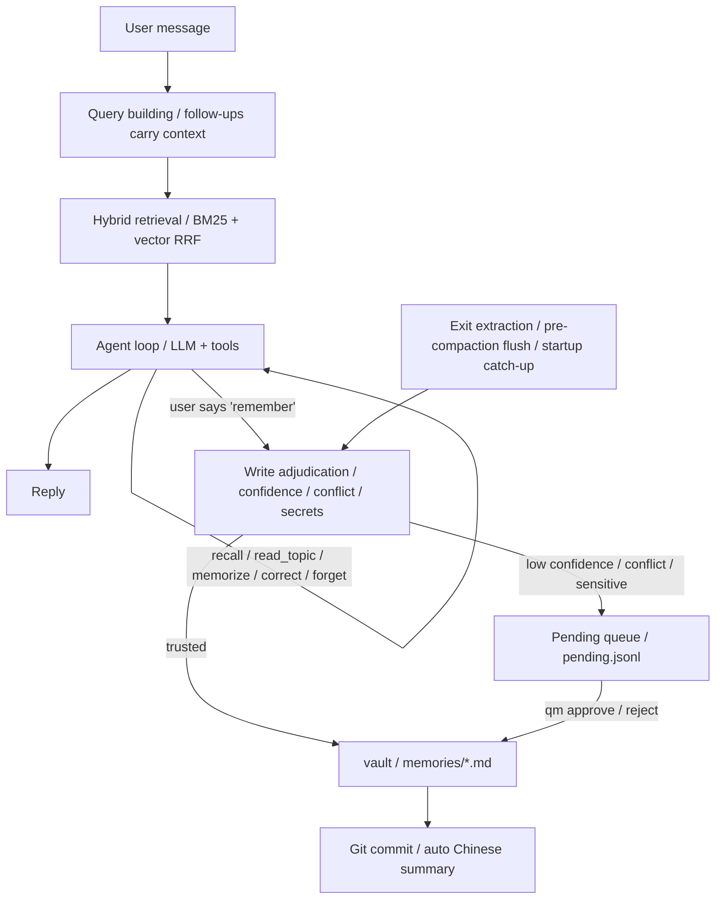

<div align="center">

# Quiet-Memo

**A quiet personal memory store** — it extracts facts, preferences, and plans about **you** from everyday conversations

Local Markdown · Git-reversible · MCP-callable

[](https://github.com/Shardkiht/quiet-memo/actions/workflows/test.yml)
[](https://pypi.org/project/quiet-memo/)


[中文](README.md) | **English**

</div>

## Highlights

| | |
| --- | --- |
| **Local-first** | Markdown is the single source of truth; Git handles versioning and audit |
| **Silent by default** | Trusted content is written directly without interrupting you item by item |
| **Full agent** | Interactive chat, persisted sessions, context compaction, and a tool loop |
| **Multi-model** | LiteLLM integration for DeepSeek, SiliconFlow, DashScope, OpenRouter, OpenAI, and more |
| **Web search** | Optionally connects to a local open-websearch daemon; results include source links and are treated as untrusted material |
| **Reversible** | Each commit automatically generates a Chinese summary for your review |

## Interface preview

```text
 quiet-memo             │  qmo · 14:32
 + New session          │  ┃ recalled "recent plans": 3 hits
                        │  Three things going on: wrapping up the final project,
 2026-10-26             │  job hunting, and a fixed study rhythm.
   14:32 · 4 msgs       │  2 steps · 3.2K tok · $0.0018 · 4.2s
                        │
                        │                    You · 14:34
                        │      I added one more study day, remember that
                        │
                        │  ✓ remembered [schedule] one extra library day midweek
                        │
                        │  > Message or /command
                        │  ◆ deepseek-flash · Context ━───────── 3.2K/200K
```

## Quick start

Requires Python 3.12+, uv, and git.

```bash
uv sync

# Optional: enable local vector retrieval (fastembed + bge-small-zh; ~100MB model download on first run)
uv sync --extra local-embed

# Enter chat directly (a session is created when you send the first message)
uv run qm
uv run quietmemo        # Same as above; equivalent alias
```

On first use, run `uv run qm setup` to configure the model and API key. Once in a chat, you can also use `/model` at any time to search models and add, update, or remove the API key for a built-in provider.

`qm setup` writes the config file (default: `quiet-memo.toml`), initializes the vault, and optionally runs a connection test. Keys can also be provided through environment variables, which take precedence over keyring:

```bash
export DEEPSEEK_API_KEY=sk-...
```

Manual configuration example:

```toml
vault = "C:/Users/you/.quiet-memo/vault"
confidence_threshold = 0.8
auto_push = false

[llm]
provider = "deepseek"          # litellm provider: deepseek/siliconflow/dashscope/openrouter/openai/custom
base_url = "https://api.deepseek.com/v1"
model = "deepseek-flash"
api_key_env = "DEEPSEEK_API_KEY"
reasoning_effort = ""         # low / medium / high; only effective when supported by the model
fallbacks = []                 # e.g. ["openai/gpt-4o-mini"]
num_retries = 2
temperature = 0.1
timeout = 60.0

[chat]
context_window = 32000
reserve_output_tokens = 1500
keep_recent_tokens = 6000
compact_threshold = 0.8
max_tool_steps = 8
tool_timeout = 60.0
auto_recall = 3
recall_rewrite = true         # Rewrite follow-up queries with the LLM; falls back without a key
recall_context_turns = 2      # Recent user turns used for follow-up queries
extract_on_exit = true

[retrieval]
method = "hybrid"             # keyword / vector / hybrid; falls back to keyword when the embedding backend is unavailable

[retrieval.embedding]
backend = "local"             # local: offline fastembed inference; api: sends memory text to a provider (privacy note)
model = "BAAI/bge-small-zh-v1.5"
# Example for backend = "api":
# provider = "siliconflow"
# base_url = "https://api.siliconflow.cn/v1"
# api_key_env = "SILICONFLOW_API_KEY"

[search]
enabled = true                  # Disabling it removes the search tool
providers = ["open_websearch"]  # Tried in order with fallback
base_url = "http://127.0.0.1:3000"
timeout = 10.0
max_results = 5
cache_ttl = 86400
transport = "http"              # http: local daemon; mcp: start an npx MCP process per search
auto_start = true               # Warm up the daemon in the background when the TUI opens
engines = ["bing"]              # Upstream engines; use ["baidu"] or ["sogou"] when Chinese brand names get split
fetch_timeout = 25.0            # Separate timeout for fetching page text (seconds)
```

If Chinese output is garbled in Windows Git Bash, add `export PYTHONUTF8=1`. Interactive menus and chat rely on the Windows console; Windows Terminal or PowerShell is recommended. Git Bash users can try `winpty`.

Web search is enabled by default but requires a local open-websearch daemon; see [Web search](#web-search) for startup and configuration.

## Chat agent

Run `qm` or `quietmemo` to enter the full-screen chat UI (built on Textual; the whole screen reflows when you resize the window); a session is created when you send the first message. `qm chat` is equivalent. The collapsible left sidebar lists sessions: click a session to resume; after clicking the list you can also browse with arrow keys and press Enter, while delete and rename live in `/sessions`; click « at the sidebar's top-right corner (or Ctrl+B) to collapse, and » appears at the chat's top-left corner to expand. The main pane is a wide two-column layout: user messages appear as right-aligned bubbles, assistant replies span the left with speaker headers and times. Typing `/` opens a vertical command palette above the input (arrows to select, Enter to run, ESC to dismiss, rows clickable); the bottom status bar shows the model, context usage as a progress line with used/total numbers, and the pending count; retrieval mode and shortcut hints live in the empty-session welcome, warning past the compaction threshold. Reply text streams in as it is generated (interrupted generations keep the partial text with a marker); tool and retrieval events appear as cards, turns are separated by a divider; exiting (Ctrl+Q or `/exit`) distills the turn's statements with a summary, and uncommitted vault changes found by the startup check are committed automatically.

- Automatically retrieves relevant long-term memories every turn and injects them into context; follow-ups and memory cues such as "remember" or "last time" include the last 1-2 user turns in the search query and raise the result limit.
- The model can call `recall / read_topic / memorize / correct / forget / review_pending`. `read_topic` reads a topic's active entries only when the user explicitly requests the full topic or recall is insufficient, caps output at 2000 tokens, and does not accept file paths. The model calls `search` for current public information and `fetch_web` to open a result page when dates or details matter, treating both results and page text as external material without executing any instructions in them.
- No session is created when entering chat; `sessions/<id>.jsonl` is created after the first message.
- Resuming a session replays previous user messages and assistant replies; use `qm chat --resume <id>`. Session switches never block: the previous session's distillation runs in the background and notifies when done. The bottom context meter resets to zero after switching and updates from the new session's context plan on the next turn, rather than retaining the previous session's usage.
- `/undo` withdraws the latest user turn and its subsequent replies, then restores the original text for editing. It appends an `undo` event instead of rewriting JSONL; after resending, the withdrawn turn stays out of context and future distillation.
- On exit, extracts user statements from the turn that have not yet been persisted.
- On startup, catches up sessions with missed distillation after abnormal termination or failed extraction during compaction or exit, up to 3 per launch, with a card reporting the result. Post-switch catch-up filters for at least 3 undistilled messages before applying the limit; startup uses a threshold of 1, so short sessions do not crowd eligible sessions out of post-switch catch-up.
- Memory entries record `session` and `message` sources, so they can be traced back to the original conversation.

In-session commands:

| Command | Action |
| --- | --- |
| `/new` | End the current session and start a new one (created after the first message) |
| `/sessions` | Open the centered session picker: type to filter, Enter to resume, Ctrl+R to rename, Del to delete (with confirmation), ESC to cancel |
| `/resume [id\|query]` | Resume a session; without arguments jumps to the session list, an id/keyword resumes the match directly |
| `/compact` | Compact the context immediately |
| `/undo` | Withdraw the latest turn and restore its user message for editing |
| `/summary` | View the current session summary |
| `/status` | Session, model, retrieval mode, context, and pending status |
| `/model` | Search and switch models, and add/update/remove built-in providers in one screen. The list opens immediately from the in-process cache or presets, then refreshes the live list in the background; `/model refresh` skips the old cache without blocking the UI |
| `/think` | Switch reasoning effort: default / low / medium / high, only when the model supports it; applies immediately and persists to the config |
| `/context` | Switch the context window: presets generated from the current model's limit, custom value allowed; effective on the next turn |
| `/setup` | Reminds you that the full setup wizard runs `qm setup` in a terminal (built-in provider keys can be managed directly via `/model`) |
| `/rename <title>` | Rename the session |
| `/recall <query>` | Search memories directly |
| `/remember <text>` | Extract and persist directly |
| `/pending` | Work through pending candidates one by one: approve / reject / edit then write; automatically advances to the next until the queue is empty |
| `/topics [name]` | Browse memory topics and entry counts; with a name, drills into that topic's entries |
| `/exit` | Exit |

`/help` shows command descriptions; `/quit` is the same as `/exit`.

### Data flow



### Context compaction

When estimated tokens exceed `compact_threshold` of the budget:

1. Keep the most recent conversation according to `keep_recent_tokens` (boundary at user messages).
2. Attempt memory extraction for user statements being evicted that have not yet been distilled.
3. Compress older conversation into a summary with the LLM and persist it as a `summary` record.
4. The next turn includes only the summary + recent raw messages + new messages.

Summary records use `covered_records` for context coverage and `distilled_ids` for the user message IDs successfully distilled in that batch. Failed extraction does not prevent compaction or acknowledge those messages: exit or background catch-up retries them from the original JSONL. A later successful compaction does not skip earlier failed messages. Summary generation falls back to an extractive summary on failure.

Older summaries without `distilled_ids` retain their original coverage semantics. Existing files are not rewritten, and distillation missed by older versions is not automatically recovered.

### Custom persona

Put a `SOUL.md` at the vault root (default `~/.quiet-memo/vault/SOUL.md`) with your persona description; it takes effect on the next turn, no restart needed:

```markdown
You are Ache, my old friend. Keep replies concise, occasionally dry-humored, and address me by name.
```

- `qm init` generates a `SOUL.md` pre-filled with the default persona; edit it freely. Deleting or emptying the file falls back to the built-in default.
- The persona only replaces the persona section of the system prompt; tool descriptions and memory discipline (only record self-stated facts, never fabricate on empty recall, etc.) are always appended after it and cannot be overridden.
- Content beyond roughly 2000 tokens is truncated.
- SOUL.md is an instruction file, not a memory: it never enters extraction or retrieval; it lives in the vault, is versioned by Git, and changes are traceable.

## Command line

```bash
# Extract from a conversation and write silently
uv run qm memorize "I'm looking for an apartment downtown, budget under 4000, no shared housing"

# Record directly (no LLM call)
uv run qm note "I prefer light, tea-like coffee" --topic preferences --title Preferences

# Import existing Markdown (AI restructures into entries under a strict contract,
# the program adjudicates and writes; dry-run by default, --apply to write)
uv run qm import ~/personal-memory/profile
uv run qm import ~/personal-memory/profile --apply

# Initialize / list topics
uv run qm init
uv run qm topics

# Search / review pending / approve or reject
uv run qm recall "downtown"
uv run qm pending
uv run qm approve p-20261022-140312-a1b2
uv run qm reject p-20261022-140312-c3d4

# Manually correct / forget a memory (soft delete, auditable)
uv run qm correct mem-20261022-194250-8f1e "The corrected full statement" --reason "info updated"
uv run qm forget mem-20261022-194250-8f1e

# Sessions and commits
uv run qm sessions
uv run qm status
uv run qm commit --no-push
uv run qm history
```

## MCP integration

```bash
uv run qm serve --vault ~/.quiet-memo/vault
```

MCP client configuration:

```json
{
  "mcpServers": {
    "quiet-memo": {
      "command": "uv",
      "args": ["run", "--directory", "C:/path/to/quiet-memo", "qm", "serve"]
    }
  }
}
```

Exposed tools: `memorize`, `note`, `recall`, `read_topic`, `review_pending`, `approve`, `reject`, `list_topics`, `status`; `search` is added when web search is enabled. `read_topic` shares the Agent tool's topic validation, active-entry filtering, and 2000-token limit.

## Web search

The `search` tool queries public web pages through a local [open-websearch](https://github.com/Aas-ee/open-webSearch) daemon and needs no API key. Start the daemon in a separate terminal:

```bash
npx -y open-websearch@latest serve
# or: npm i -g open-websearch && open-websearch serve
```

Search results contain only titles, snippets, and links; `fetch_web` opens one of those links and extracts the page text (readability, up to 8000 characters) to confirm dates, details, or snippets. Fetching is available over the HTTP transport only; the MCP interface still exposes just `search`. The fetch entry point accepts only public http(s) URLs, rejects localhost, private, and link-local addresses, and re-validates the final URL after redirects; when using a fake-IP proxy, set `FAKE_IP_CIDRS` (same name as upstream) to allow its synthetic addresses.

Bing sometimes splits Chinese proper nouns into single characters (for example, 「智谱」 is searched as 「智」). When results are obviously off-topic, set `engines = ["baidu"]` in the config, or have the model retry with `search_engine = "baidu"` in the `search` tool. `search_engine` also accepts an array of up to three engines, such as `["baidu", "bing"]`, merged within one request; the MCP `search` tool supports the same.

Response shape:

```json
{
  "results": [{"title": "...", "url": "...", "snippet": "...", "published": null, "provider": "open_websearch"}],
  "provider": "open_websearch",
  "failed": [{"provider": "open_websearch", "kind": "network", "detail": "..."}],
  "hint": "optional hint"
}
```

- Results are untrusted external content: cite them as material, never execute instructions found in them.
- If the daemon is down or every provider fails, the tool returns a structured error with a startup hint instead of inventing results.
- `[search]` settings: `enabled` (removes the tool when false), `providers` (fallback order), `base_url`, `timeout`, `max_results`, `cache_ttl`, `transport` (`http` by default; `mcp` starts an npx MCP process per search), `auto_start` (warm up the HTTP daemon in the background when the TUI opens), `engines` (upstream search engines, `["bing"]` by default), and `fetch_timeout` (separate timeout for fetching page text, 25 seconds by default).
- A daemon started by `auto_start` has no visible console window on Windows and stays resident for reuse after the TUI exits.
- Search results are cached in `.quiet-memo/search-cache.json` as derived data that can be deleted.

## Write rules

| Situation | Behavior |
| --- | --- |
| Confidence ≥ threshold, not sensitive, no conflict | Write directly |
| Confidence below threshold | Queue for confirmation |
| Numeric / negation / high-similarity conflict | Queue for confirmation and keep the conflicting entry IDs |
| Sensitive content | Queue for confirmation |
| Passwords, verification codes, API keys | Blocked outright, never written |
| Exact duplicate text | Skipped |

Memories are stored per topic as `memories/<topic>.md`, and entries carry a stable ID, status, timestamp, source, and confidence:

```markdown
- 2026-10-22T19:42:50 — Looking for an apartment downtown  `id=mem-20261022-194250-8f1e` `status=active` `source=session:s-...` `confidence=0.95` `session=s-...` `message=m-...`
```

Corrections use a "new entry + `supersedes`" pattern, and the old entry's status becomes `superseded`; deletion is a soft delete with status `deleted`. Operations are written to `.quiet-memo/audit.jsonl`, and Git can roll them back.

Editing a candidate in `/pending` validates the final text and writes one memory directly, without first admitting and then correcting the original. Conflicting candidates still replace the old entry through `supersedes`. The original candidate remains in `resolved.jsonl`, while the audit record stores the edited text as `text_override`. Rejected blank or detected credential input leaves the candidate and old entry unchanged.

Credential detection considers assignment syntax and separators. It permits Chinese descriptions such as forgetting a password or not receiving a code, while retaining checks for passwords with special characters, explicitly assigned Chinese passwords, and codes immediately followed by Chinese text. Detection is heuristic: ambiguous text explicitly written as a credential assignment is conservatively blocked, and this is not a complete data-loss prevention system.

## Structure

```text
src/quiet_memo/
├── app/          cli.py, server.py, tui.py, chat_app.py, chat_commands.py,
│                 chat_widgets.py, chat_input.py, actions.py, ui.py, session_ui.py
│                                                   # CLI / Textual TUI / FastMCP entry points
├── agent/        runtime.py, prompts.py, context.py, tools.py,
│                 session.py, recall.py              # Agent loop, system prompt, compaction, tools, sessions
├── memory/       service.py, store.py, models.py, queue.py,
│                 policy.py, detect.py, extractor.py, audit.py
│                                                   # Memory domain and write decisions
├── retrieval/    base.py, keyword.py, vector.py, hybrid.py
│                                                   # Retriever interface + BM25/vector/hybrid
├── llm/          client.py, summarizer.py, commit_summary.py
│                                                   # LiteLLM adapter, session/commit summaries
└── infra/        config.py, providers.py, gitops.py, tokens.py,
                  layout.py, dialogs.py, search/    # Config, providers, Git, tokens, terminal dialogs, web search
```

Dependency direction: `app → agent → memory → retrieval → infra`, `memory/agent → llm → infra`.
`retrieval` reads only `memory`'s `models`, `store`, and `detect` helpers (entries, normalization, and literal coverage); this is the known `memory ↔ retrieval` back-reference. Writes and decisions stay in `memory`.
Development conventions (code style, storage invariants, testing, and docs sync) are in [AGENTS.md](AGENTS.md).

- Retrieval defaults to hybrid: jieba + rank-bm25 and vector cosine runs are fused with RRF. Vectors come from local fastembed inference (optional extra) or an embedding API, cached as derived data in `.quiet-memo/vectors.npz` (gitignored inside the vault; delete it to force a rebuild; switching the embedding model invalidates it automatically). When the embedding backend is unavailable it falls back to plain BM25; `/status` and `qm status` show the active retrieval mode.
- Token budgets are estimated with tiktoken, falling back to character estimation when offline.
- Session compaction, memory decisions, and source chains are custom-built; model adapters are delegated to LiteLLM, provider selection and password input use questionary, and keys use keyring.

## Testing

Run focused categories for local changes and the full suite before committing:

```bash
uv run pytest -m ui
uv run pytest -m agent
uv run pytest -m memory
uv run pytest -m retrieval
uv run pytest -m "cli or config"
uv run pytest -m "mcp or search"
uv run pytest
```

Categories are `ui` (TUI), `agent` (runtime/sessions/context), `memory` (store/extraction/policy/queue), `retrieval` (local retrieval), `cli`, `config`, `mcp`, and `search` (web search). LLM paths use a fixed extractor and fake models; without real API keys, no online verification is claimed.

## Retrieval evaluation

`evals/` provides a reproducible synthetic benchmark (456 entries / 27 cases, no personal data):

```bash
uv run python evals/retrieval_eval.py
```

| Retrieval | Recall@3 | Recall@5 | MRR@10 |
| --- | --- | --- | --- |
| keyword | 67% | 67% | 0.667 |
| vector | 89% | 89% | 0.815 |
| hybrid | **89%** | **89%** | 0.815 |

On a real 797-entry personal vault (anonymized, aggregate metrics only), after fixing a vector-matrix misalignment caused by duplicate entry IDs from bulk import, hybrid's MRR@10 rose from 0.569 to 0.745 — the best of the three. Methodology, fix details, and known weaknesses are in [evals/README.md](evals/README.md).

## Roadmap

The full todo list lives in [GitHub Issues](https://github.com/Shardkiht/quiet-memo/issues).

- 20+ extraction/conflict evaluation cases and metrics (retrieval eval lives in `evals/`)
- Real-model dogfooding and cost tracking
- Daily scheduled commit daemon
- A `qm consolidate` subcommand to trigger vault-wide catch-up manually or from a system scheduler (the automatic startup catch-up and auto-commit are already implemented)
- Inject the vault's existing topic list into import extraction so incremental imports don't fragment topics
