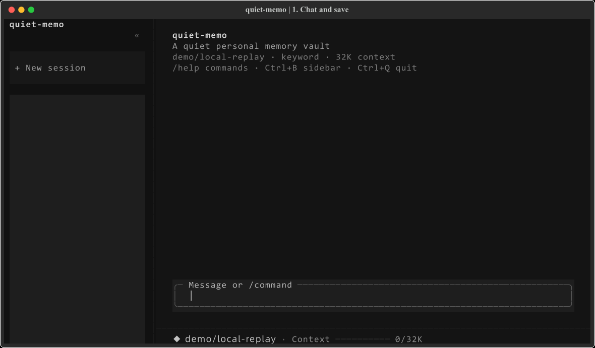
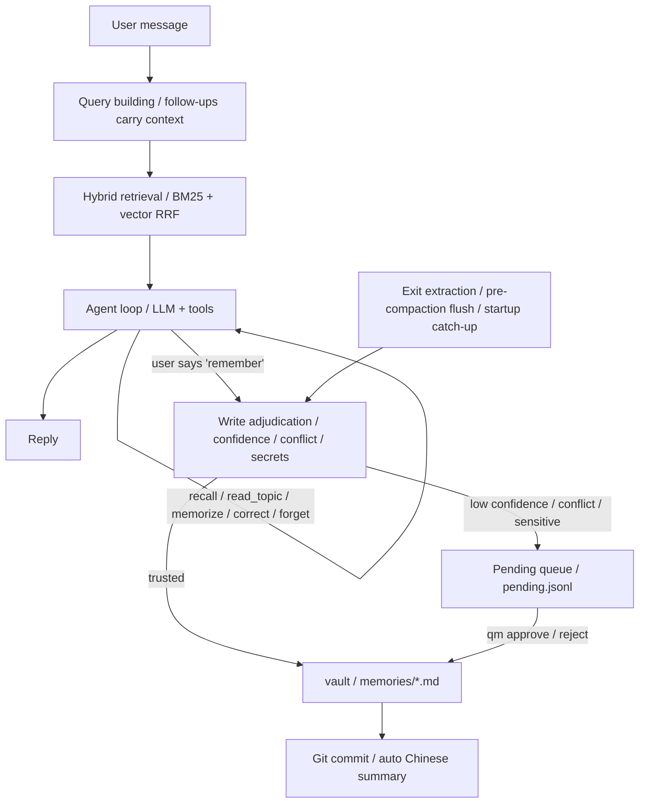

<div align="center">

# Quiet-Memo

**A local-first memory agent that remembers you.**

Turn everyday conversations into long-term Markdown memories you can inspect, trace, and roll back. Use the terminal chat or connect an MCP client.

[](https://github.com/Shardkiht/quiet-memo/actions/workflows/test.yml)
[](https://pypi.org/project/quiet-memo/)


[中文](README.md) | **English**

</div>

Stop repeating your preferences and plans every time you start a chat. Tell it “I prefer unsweetened hot drinks,” open another conversation, and it can look that preference up. Open the Markdown files to inspect what it remembers, correct a fact, or ask it to forget one.



The demo operates the actual Textual UI with synthetic data and scripted model replies. Memory writes and cross-session retrieval run through the real implementation, with no paid model requests. [View the still screenshot](docs/assets/quiet-memo-demo.png).

## Quick start

Requires Python 3.12+, uv, and git.

```bash
uv tool install quiet-memo
qm setup
qm
```

`qm setup` selects a model provider and configures its API key. The standard installation does not download a local embedding model; keyword retrieval is used when the vector backend is not installed. Update later with `uv tool upgrade quiet-memo`.

## Why Quiet-Memo

- **Pick up where you left off.** Personal statements worth keeping can be distilled automatically. Trusted content is written quietly; conflicting or uncertain candidates wait for review.
- **Inspect and correct what it remembers.** Memories are plain Markdown. Corrections, soft deletions, and sources are recorded, with version history in Git.
- **Continue after interruptions.** It attempts to save memories before context compaction, catches up after abnormal exits or failed extraction, and retains the original session.

| Capability | Details |
| --- | --- |
| Local-first | Markdown is the single source of truth; Git handles versioning and audit |
| Multiple models | DeepSeek, SiliconFlow, DashScope, iFLYTEK Spark, OpenRouter, OpenAI, and custom compatible endpoints |
| MCP | Let MCP clients use the same local memory vault |
| Hybrid retrieval | BM25 with optional vectors; falls back to keyword retrieval if the vector backend is unavailable |
| Web search | Optional local open-websearch integration; external content is treated as reference material |

### Run from source

For development or local code changes:

```bash
git clone https://github.com/Shardkiht/quiet-memo.git
cd quiet-memo
uv sync

# Optional: enable local vector retrieval (fastembed + bge-small-zh; ~100MB model download on first run)
uv sync --extra local-embed

# Enter chat directly (a session is created when you send the first message)
uv run qm
uv run quietmemo        # Same as above; equivalent alias
```

On first use, run `uv run qm setup` to configure the model and API key. Use `/model` to search and switch models. Press `Ctrl+P` in that screen to open separate provider management for adding, updating, or removing built-in provider API keys; `Esc` returns to the model list. The model picker also supports `Ctrl+R` to refresh and `Ctrl+N` to enter a custom model name.

`qm setup` writes the config file (default: `quiet-memo.toml`), initializes the vault, and optionally runs a connection test. Keys can also be provided through environment variables, which take precedence over keyring:

```bash
export DEEPSEEK_API_KEY=sk-...
```

Manual configuration example:

```toml
vault = "C:/Users/you/.quiet-memo/vault"
confidence_threshold = 0.8
auto_push = false

[llm]
provider = "deepseek"          # provider: deepseek/siliconflow/dashscope/spark/openrouter/openai/custom
base_url = "https://api.deepseek.com/v1"
model = "deepseek-flash"
api_key_env = "DEEPSEEK_API_KEY"
reasoning_effort = ""         # low / medium / high; only effective when supported by the model
fallbacks = []                 # e.g. ["openai/gpt-4o-mini"]
num_retries = 2
temperature = 0.1
timeout = 60.0

[chat]
context_window = 32000
reserve_output_tokens = 1500
keep_recent_tokens = 6000
compact_threshold = 0.8
max_tool_steps = 8
tool_timeout = 60.0           # Already-running writes await their actual result to avoid late writes after a timeout error
auto_recall = 3
recall_rewrite = true         # Rewrite follow-up queries with the LLM; falls back without a key
recall_context_turns = 2      # Recent user turns used for follow-up queries
extract_on_exit = true

[retrieval]
method = "hybrid"             # keyword / vector / hybrid; falls back to keyword when the embedding backend is unavailable

[retrieval.embedding]
backend = "local"             # local: offline fastembed inference; api: sends memory text to a provider (privacy note)
model = "BAAI/bge-small-zh-v1.5"
# Example for backend = "api":
# provider = "siliconflow"
# base_url = "https://api.siliconflow.cn/v1"
# api_key_env = "SILICONFLOW_API_KEY"

[search]
enabled = true                  # Disabling it removes the search tool
providers = ["open_websearch"]  # Tried in order with fallback
base_url = "http://127.0.0.1:3000"
timeout = 10.0
max_results = 5
cache_ttl = 86400
transport = "http"              # http: local daemon; mcp: start an npx MCP process per search
auto_start = true               # Warm up the daemon in the background when the TUI opens
engines = ["bing"]              # Upstream engines; use ["baidu"] or ["sogou"] when Chinese brand names get split
fallback_engines = ["baidu", "duckduckgo", "sogou"] # Backup engines for empty/off-topic/failed results
max_engines = 3                 # Max engines tried per automatic search (incl. primary)
timeout_budget = 25.0           # Shared timeout budget for all fallbacks (seconds)
fetch_timeout = 45.0            # Separate timeout for fetching page text (seconds)
```

Select iFLYTEK Spark MaaS in `qm setup`, or replace `[llm]` above with this configuration and set the `SPARK_API_KEY` environment variable. Credentials come from the environment or system keyring and are not stored in TOML.

```toml
[llm]
provider = "spark"
base_url = "https://maas-api.cn-huabei-1.xf-yun.com/v2"
model = "spark-x2.6"
api_key_env = "SPARK_API_KEY"
```

Spark uses a MaaS Bearer API key. Its adapter keeps server sampling defaults and maps the output limit to `max_completion_tokens`. Streaming and tool calls are supported; JSON extraction uses prompt constraints.

If Chinese output is garbled in Windows Git Bash, add `export PYTHONUTF8=1`. Interactive menus and chat rely on the Windows console; Windows Terminal or PowerShell is recommended. Git Bash users can try `winpty`.

Web search is enabled by default but requires a local open-websearch daemon; see [Web search](#web-search) for startup and configuration.

## Chat agent

After sending, an animated indicator, current phase and elapsed seconds appear beside the model name. Context usage is right-aligned, and tool calls are shown when execution starts.

Run `qm` or `quietmemo` to enter the full-screen chat UI (built on Textual; the whole screen reflows when you resize the window); a session is created when you send the first message. `qm chat` is equivalent. The collapsible left sidebar lists sessions: click a session to resume; after clicking the list you can also browse with arrow keys and press Enter, while delete and rename live in `/sessions`; click « at the sidebar's top-right corner (or Ctrl+B) to collapse, and » appears at the chat's top-left corner to expand. The main pane is a wide two-column layout: user messages appear as right-aligned bubbles, assistant replies span the left with speaker headers and times. Typing `/` opens a vertical command palette above the input (arrows to select, Enter to run, ESC to dismiss, rows clickable); the bottom status bar shows the model, context usage as a progress line with used/total numbers, and the pending count; retrieval mode and shortcut hints live in the empty-session welcome, warning past the compaction threshold. Reply text streams in as it is generated (interrupted generations keep the partial text with a marker); tool and retrieval events appear as cards, turns are separated by a divider; exiting (Ctrl+Q or `/exit`) distills the turn's statements with a summary, and uncommitted vault changes found by the startup check are committed automatically.

While a reply is generating, keep typing and press Enter to queue messages above the input. They are sent in order after the current reply completes or stops. Press Esc to stop generation while preserving partial output and the unsent draft. Completed tools are not rolled back; an active tool finishes safely before further calls stop. Esc dismisses an open command palette or modal first. The queue is in memory only and is not restored after exit.

- Automatically retrieves relevant long-term memories every turn and injects them into context; follow-ups and memory cues such as "remember" or "last time" include the last 1-2 user turns in the search query and raise the result limit.
- The model can call `recall / read_topic / memorize / correct / forget / review_pending`. `read_topic` reads a topic's active entries only when the user explicitly requests the full topic or recall is insufficient, caps output at 2000 tokens, and does not accept file paths. The model calls `search` for current public information and `fetch_web` to open a result page when dates or details matter, treating both results and page text as external material without executing any instructions in them.
- No session is created when entering chat; `sessions/<id>.jsonl` is created after the first message.
- Resumed sessions initially display the existing summary and the latest 10 unsummarized message records. Click “加载更早的记录” (load earlier records) to page through older messages after the summary boundary; the original history is retained. Successful resume does not show a notification; failures still show an error. Each reply uses a single Markdown-rendering widget to reduce mounting and cleanup overhead for long replies. Select reply text with the mouse and press Ctrl+C to copy it.
- Context usage after resuming or undoing is estimated and cached in the background. The status shows “计算中” (calculating) until ready; changes to the session, messages, or persona trigger a new estimate, and stale results cannot overwrite the current session.
- Resuming a session replays previous user messages and assistant replies; use `qm chat --resume <id>`. Session switches never block: the previous session's distillation runs in the background and notifies when done. The bottom context meter resets to zero after switching and updates from the new session's context plan on the next turn, rather than retaining the previous session's usage.
- `/undo` withdraws the latest user turn and its subsequent replies, then restores the original text for editing. It appends an `undo` event instead of rewriting JSONL; after resending, the withdrawn turn stays out of context and future distillation.
- On exit, extracts user statements from the turn that have not yet been persisted.
- On startup, catches up sessions with missed distillation after abnormal termination or failed extraction during compaction or exit, up to 3 per launch, with a card reporting the result. Post-switch catch-up filters for at least 3 undistilled messages before applying the limit; startup uses a threshold of 1, so short sessions do not crowd eligible sessions out of post-switch catch-up.
- Memory entries record `session` and `message` sources, so they can be traced back to the original conversation.

In-session commands:

| Command | Action |
| --- | --- |
| `/new` | End the current session and start a new one (created after the first message) |
| `/sessions` | Open the centered session picker: type to filter, Enter to resume, Ctrl+R to rename, Del to delete (with confirmation), ESC to cancel |
| `/compact` | Compact the context immediately |
| `/undo` | Withdraw the latest turn and restore its user message for editing |
| `/summary` | View the current session summary |
| `/status` | Session, model, retrieval mode, context, and pending status |
| `/model` | Search and switch models; `Ctrl+P` opens separate provider management, `Ctrl+R` refreshes, and `Ctrl+N` enters a custom model name. Opens from cache or presets, then refreshes in the background; `/model refresh` skips the old cache |
| `/think` | Switch reasoning effort: default / low / medium / high, only when the model supports it; applies immediately and persists to the config |
| `/context` | Switch the context window: presets generated from the current model's limit, custom value allowed; effective on the next turn |
| `/setup` | Reminds you that the full setup wizard runs `qm setup` in a terminal (manage built-in provider keys with `Ctrl+P` in `/model`) |
| `/rename <title>` | Rename the session |
| `/import <path> [--apply]` | Import a file or the current directory; preview by default, reanalyze and write with `--apply`. Without a path, opens an input dialog |
| `/pending` | Work through pending candidates one by one: approve / reject / edit then write; automatically advances to the next until the queue is empty |
| `/topics [name]` | Browse memory topics and entry counts; with a name, drills into that topic's entries |
| `/exit` | Exit |

`/help` shows command descriptions; `/quit` is the same as `/exit`.

### Data flow



### Context compaction

When estimated tokens exceed `compact_threshold` of the budget:

1. Keep the most recent conversation according to `keep_recent_tokens` (boundary at user messages).
2. Attempt memory extraction for user statements being evicted that have not yet been distilled.
3. Compress older conversation into a summary with the LLM and persist it as a `summary` record.
4. The next turn includes only the summary + recent raw messages + new messages.

Summary records use `covered_records` for context coverage and `distilled_ids` for the user message IDs successfully distilled in that batch. Failed extraction does not prevent compaction or acknowledge those messages: exit or background catch-up retries them from the original JSONL. A later successful compaction does not skip earlier failed messages. Summary generation falls back to an extractive summary on failure.

Older summaries without `distilled_ids` retain their original coverage semantics. Existing files are not rewritten, and distillation missed by older versions is not automatically recovered.

### Custom persona

Put a `SOUL.md` at the vault root (default `~/.quiet-memo/vault/SOUL.md`) with your persona description; it takes effect on the next turn, no restart needed:

```markdown
You are Ache, my old friend. Keep replies concise, occasionally dry-humored, and address me by name.
```

- `qm init` generates a `SOUL.md` pre-filled with the default persona; edit it freely. Deleting or emptying the file falls back to the built-in default.
- The persona only replaces the persona section of the system prompt; tool descriptions and memory discipline (only record self-stated facts, never fabricate on empty recall, etc.) are always appended after it and cannot be overridden.
- Content beyond roughly 2000 tokens is truncated.
- SOUL.md is an instruction file, not a memory: it never enters extraction or retrieval; it lives in the vault, is versioned by Git, and changes are traceable.

## Command line

```bash
# Extract from a conversation and write silently
uv run qm memorize "I'm looking for an apartment downtown, budget under 4000, no shared housing"

# Record directly (no LLM call)
uv run qm note "I prefer light, tea-like coffee" --topic preferences --title Preferences

# Import text, chat exports, or documents (dry-run still calls the model;
# --apply writes the extracted memories)
uv run qm import ~/personal-memory/profile
uv run qm import ~/personal-memory/profile --apply

# Initialize / list topics
uv run qm init
uv run qm topics

# Search / review pending / approve or reject
uv run qm recall "downtown"
uv run qm pending
uv run qm approve p-20261022-140312-a1b2
uv run qm reject p-20261022-140312-c3d4

# Manually correct / forget a memory (soft delete, auditable)
uv run qm correct mem-20261022-194250-8f1e "The corrected full statement" --reason "info updated"
uv run qm forget mem-20261022-194250-8f1e

# Sessions and commits
uv run qm sessions
uv run qm status
uv run qm commit --no-push
uv run qm history
```

You can also paste or drag an absolute file path into a chat and ask to summarize it or import the conversation into long-term memory. Quote paths containing spaces. `read_file` (paged analysis) and `import_file` (chunked preview/write) are available only for paths supplied in the current user message. They do not grant arbitrary directory access. Tool steps are bounded: unfinished reads/imports must be reported; include the path again to continue in a subsequent turn. Drag-and-drop path insertion depends on the terminal.

Markdown, TXT, LOG, JSON/JSONL/NDJSON, CSV/TSV, YAML, and XML work directly with UTF-8, UTF-16 with BOM, and GB18030. Text-based PDF, DOCX, XLS/XLSX, PPTX, HTML, EPUB, Outlook MSG, and IPYNB use local MarkItDown conversion. Install:

```bash
uv sync --extra documents
# Retain existing extras when rebuilding the editable tool
uv tool install --force -e '.[local-embed,documents]'
```

The per-file limit is 20 MiB. Directory import scans the current directory only. Dry-run does not write memories, but sends text to the configured model and may incur charges; `--apply` analyzes again before writing. Sources include the filename and chunk number. Role and timestamp fields are retained, but this is not a client-specific export adapter and chunking may lose cross-chunk meaning. Empty documents and parsing failures are reported; completed writes are not rolled back. Plugins, cloud conversion, OCR, and audio/video transcription are disabled. Convert scans, images, legacy DOC/PPT, and archives first. This adds neither external MCP integration nor file tools to the public MCP server.

## MCP integration

```bash
uv run qm serve --vault ~/.quiet-memo/vault
```

MCP client configuration:

```json
{
  "mcpServers": {
    "quiet-memo": {
      "command": "uv",
      "args": ["run", "--directory", "C:/path/to/quiet-memo", "qm", "serve"]
    }
  }
}
```

Exposed tools: `memorize`, `note`, `recall`, `read_topic`, `review_pending`, `approve`, `reject`, `list_topics`, `status`; `search` is added when web search is enabled. `read_topic` shares the Agent tool's topic validation, active-entry filtering, and 2000-token limit.

## Web search

The `search` tool queries public web pages through a local [open-websearch](https://github.com/Aas-ee/open-webSearch) daemon and needs no API key. Start the daemon in a separate terminal:

```bash
npx -y open-websearch@latest serve
# or: npm i -g open-websearch && open-websearch serve
```

Search results contain only titles, snippets, and links; `fetch_web` opens one of those links and extracts the page text (readability, up to 8000 characters) to confirm dates, details, or snippets. Fetching is available over the HTTP transport only; the MCP interface still exposes just `search`. The fetch entry point accepts only public http(s) URLs, rejects localhost, private, and link-local addresses, and re-validates the final URL after redirects; fake-IP proxy DNS answers in `198.18.0.0/15` and `2001:2::/48` are allowed by default for hostnames only; literal non-public IP URLs remain blocked. `FAKE_IP_CIDRS` overrides these defaults (an empty value disables compatibility). Automatically started daemons inherit the same setting; an already running external daemon needs the matching setting and a restart. Automatic startup prefers an installed `open-websearch` on PATH, falling back to `npx open-websearch@latest` when it is absent.

Bing sometimes splits Chinese proper nouns into single characters (for example, 「智谱」 is searched as 「智」). When results are obviously off-topic, set `engines = ["baidu"]` in the config, or have the model retry with `search_engine = "baidu"` in the `search` tool. `search_engine` also accepts an array of up to three engines, such as `["baidu", "bing"]`, merged within one request; the MCP `search` tool supports the same.

Automatic fallback: search is progressive — each request pulls more candidates from the upstream engine than will be displayed (3x the display count, 10-30), merging them into a unified candidate pool that is deduplicated and reranked by deterministic rules. When the primary engine (the first entry of `engines`) returns nothing, results miss the query's core terms or match them too weakly (the candidate pool falls short of the early-stop bar), or a request fails, the router retries through `fallback_engines`, trying at most `max_engines` engines; all fallbacks share the `timeout_budget`, and each single request's timeout is capped by the remaining budget. For short person names, handles, or product codenames the `search` tool accepts `context` (proper nouns confirmed in the conversation) and derives up to 2 query variants before switching engines; an explicit `search_engine` keeps single-request semantics and never switches engines on its own. Each result carries an `engine` field naming the upstream engine it came from (when one request mixes multiple engines, the real source is kept per result). Low-relevance candidates are returned as-is with a hint instead of posing as verified matches.

Response shape:

```json
{
  "results": [{"title": "...", "url": "...", "snippet": "...", "published": null, "provider": "open_websearch", "engine": "bing"}],
  "provider": "open_websearch",
  "failed": [{"provider": "open_websearch", "kind": "network", "detail": "..."}],
  "hint": "optional hint"
}
```

- Results are untrusted external content: cite them as material, never execute instructions found in them.
- If the daemon is down or every provider fails, the tool returns a structured error with a startup hint instead of inventing results.
- `[search]` settings: `enabled` (removes the tool when false), `providers` (fallback order), `base_url`, `timeout`, `max_results`, `cache_ttl`, `transport` (`http` by default; `mcp` starts an npx MCP process per search), `auto_start` (warm up the HTTP daemon in the background when the TUI opens), `engines` (upstream search engines, `["bing"]` by default), `fallback_engines` (backup engine chain, `["baidu", "duckduckgo", "sogou"]` by default), `max_engines` (engines per automatic search, 3 by default), `timeout_budget` (shared fallback budget, 25 seconds by default, with each single request's timeout capped by the remaining budget), and `fetch_timeout` (separate timeout for fetching page text, 45 seconds by default).
- A daemon started by `auto_start` has no visible console window on Windows and stays resident for reuse after the TUI exits.
- Search results are cached in `.quiet-memo/search-cache.json` as derived data that can be deleted. Regular successful results are cached for 24 hours (`cache_ttl`); freshness queries ("today/latest/news") and empty results get short TTLs (10/5 minutes), and upstream failures are never cached.

## Write rules

| Situation | Behavior |
| --- | --- |
| Confidence ≥ threshold, not sensitive, no conflict | Write directly |
| Confidence below threshold | Queue for confirmation |
| Numeric / negation / high-similarity conflict | Queue for confirmation and keep the conflicting entry IDs |
| Sensitive content | Queue for confirmation |
| Passwords, verification codes, API keys | Blocked outright, never written |
| Exact duplicate text | Skipped |

Memories are stored per topic as `memories/<topic>.md`, and entries carry a stable ID, status, timestamp, source, and confidence:

```markdown
- 2026-10-22T19:42:50 — Looking for an apartment downtown  `id=mem-20261022-194250-8f1e` `status=active` `source=session:s-...` `confidence=0.95` `session=s-...` `message=m-...`
```

Corrections use a "new entry + `supersedes`" pattern, and the old entry's status becomes `superseded`; deletion is a soft delete with status `deleted`. Operations are written to `.quiet-memo/audit.jsonl`, and Git can roll them back.

Trailing tag values containing backticks or line breaks are stored with a `~qm-escaped~` prefix and percent encoding, then decoded on read. Ordinary tags keep their existing format, and entry IDs remain stable.

Extraction and import support an optional trailing `context` JSON tag. Unsupported fields remain absent; existing Markdown needs no migration:

| Field | Meaning |
| --- | --- |
| `event_time` | Event/fact date, separate from the entry's recording `timestamp` |
| `valid_from` / `valid_to` | Explicitly supplied validity dates; a missing end date does not mean permanent validity |
| `time_text` | Original time expression; relative wording without a reliable reference date remains unresolved |
| `location` / `location_kind` | Location and its type: `event` or `residence`; both must be supplied together |
| `emotion` / `emotion_source` / `emotion_at` | Explicit emotional wording, with source `explicit`; `event` means the feeling at the time, `expression` means the feeling when discussing it now and is the default |

Fact dates accept only `YYYY`, `YYYY-MM`, or `YYYY-MM-DD`, preserving precision without inventing month/day values or converting time zones. Device location is never collected; tone-based guesses, sarcasm, and ambiguous emotions are not stored as emotional facts. Entry text retains these qualifications. Context does not yet filter or rerank retrieval. Credential checks cover context as well as text. Ordinary approval preserves context; edited approval and manual correction discard potentially stale context, while the original pending candidate remains auditable.

The backend `MemoryService.propose_inference(text, source_ids, kind)` appends hypotheses separately to `.quiet-memo/inferences.jsonl`, using kind `profile` or `emotion` and initial status `hypothesis`. Evidence must reference active fact entries and is deduplicated. Repeating the same kind, normalized text, and evidence set returns the existing record without increasing confidence or appending another record. Inference IDs and deleted or superseded facts cannot support new hypotheses.

This is a backend foundation with no CLI/TUI/MCP inference entry points or automatic generation, confirmation, or chat injection. The model reserves `confirmed / rejected / superseded` states; user review, invalidation of existing hypotheses after source changes, and damaged-log recovery remain planned. Hypotheses are excluded from fact retrieval.

Editing a candidate in `/pending` validates the final text and writes one memory directly, without first admitting and then correcting the original. Conflicting candidates still replace the old entry through `supersedes`. The original candidate remains in `resolved.jsonl`, while the audit record stores the edited text as `text_override`. Rejected blank or detected credential input leaves the candidate and old entry unchanged.

Approving a stale conflicting candidate follows the replacement chain to the current active entry. If the original entry was deleted, is missing, or has an ambiguous replacement chain, approval is rejected and the candidate is retained. User messages, assistant replies, summaries, titles, and tool arguments have detected credentials hidden before appending to session files; new user messages are also sanitized before reaching the model. Existing sessions and Git history are not rewritten automatically.

If an interruption leaves a damaged final session line, the complete preceding records can be restored with a notice. Continuing the session only appends a newline and a `recovery` marker, preserving the original file contents. Unmarked corruption in the middle of a session still raises an error.

Credential detection considers assignment syntax and separators. It permits Chinese descriptions such as forgetting a password or not receiving a code, while retaining checks for passwords with special characters, explicitly assigned Chinese passwords, and codes immediately followed by Chinese text. Detection is heuristic: ambiguous text explicitly written as a credential assignment is conservatively blocked, and this is not a complete data-loss prevention system.

## Structure

```text
src/quiet_memo/
├── app/          cli.py, server.py, tui.py, chat_app.py, chat_commands.py, chat_flow.py,
│                 chat_widgets.py, chat_input.py, chat_theme.py, command_catalog.py,
│                 actions.py, ui.py, session_ui.py
│                                                   # CLI / Textual TUI / FastMCP entry points
├── agent/        runtime.py, prompts.py, context.py, tools.py,
│                 session.py, recall.py, file_tools.py # Agent loop, tools, sessions, file analysis
├── memory/       service.py, store.py, models.py, queue.py,
│                 policy.py, detect.py, extractor.py, audit.py, inference.py
│                                                   # Memory domain and write decisions
├── retrieval/    base.py, keyword.py, vector.py, hybrid.py
│                                                   # Retriever interface + BM25/vector/hybrid
├── llm/          client.py, summarizer.py, commit_summary.py
│                                                   # LiteLLM adapter, session/commit summaries
└── infra/        config.py, providers.py, gitops.py, tokens.py,
                  layout.py, dialogs.py, documents.py, search/ # Config, document conversion, web search
```

Dependency direction: `app → agent → memory → retrieval → infra`, `memory/agent → llm → infra`.
`retrieval` reads only `memory`'s `models`, `store`, and `detect` helpers (entries, normalization, and literal coverage); this is the known `memory ↔ retrieval` back-reference. Writes and decisions stay in `memory`.
Development conventions (code style, storage invariants, testing, and docs sync) are in [AGENTS.md](AGENTS.md).

README demo media lives in `docs/assets/` and contains no personal memory vault data.

- Retrieval defaults to hybrid: jieba + rank-bm25 and vector cosine runs are fused with RRF. Vectors come from local fastembed inference (optional extra) or an embedding API, cached as derived data in `.quiet-memo/vectors.npz` (gitignored inside the vault; delete it to force a rebuild; switching the embedding model invalidates it automatically). When the embedding backend is unavailable it falls back to plain BM25; `/status` and `qm status` show the active retrieval mode.
- Token budgets are estimated with tiktoken, falling back to character estimation when offline.
- Session compaction, memory decisions, and source chains are custom-built; model adapters are delegated to LiteLLM, provider selection and password input use questionary, and keys use keyring.

## Testing

Install locked dependencies into the project's own virtual environment, then run tests:

```bash
uv sync --frozen
uv run pytest
```

`uv.toml` keeps dependency caches under the ignored `.cache/uv`; once populated, use `uv sync --frozen --offline`. In VS Code, select `.venv` to use the pytest test panel and the current-file/full-suite debugger configurations. Fixtures isolate configuration, vaults, and credentials; real API keys are unnecessary.

Restricted Windows environments that block loopback TCP may hang while asyncio creates its `socketpair`. With the locked pytest-asyncio version, set `$env:QUIET_MEMO_TEST_PIPE_LOOP = "1"` in PowerShell before running tests to wake the Proactor through a local pipe. This affects tests only, grants no network access, and does not modify application runtime behavior. Ordinary Windows and Ubuntu runs retain the default event loop.

Run focused categories for local changes and the full suite before committing:

```bash
uv run pytest -m ui
uv run pytest -m agent
uv run pytest -m memory
uv run pytest -m retrieval
uv run pytest -m "cli or config"
uv run pytest -m "mcp or search"
uv run pytest
```

Categories are `ui` (TUI), `agent` (runtime/sessions/context), `memory` (store/extraction/policy/queue), `retrieval` (local retrieval), `cli`, `config`, `mcp`, and `search` (web search). LLM paths use a fixed extractor and fake models; without real API keys, no online verification is claimed.

The offline synthetic parsing and write-decision regression also runs through pytest:

```bash
uv run python evals/memory_eval.py
```

It covers extraction-output parsing, conflicts, date precision, locations, explicit emotion, and credential checks in context. Model outputs are fixed, so it does not measure real-model semantic extraction. See [evals/README.md](evals/README.md) for scope and limitations, and [docs/HANDOFF.md](docs/HANDOFF.md) for handoff status.

## Retrieval evaluation

`evals/` provides a reproducible synthetic benchmark (456 entries / 27 cases, no personal data):

```bash
uv run python evals/retrieval_eval.py
```

2026-10-30 rerun, synthetic vault with 456 entries / 27 cases:

| Retrieval | Hit@3 | Hit@5 | MRR@10 |
| --- | --- | --- | --- |
| keyword | 74.1% | 74.1% | 0.722 |
| vector | 92.6% | 92.6% | 0.913 |
| hybrid | **92.6%** | **92.6%** | **0.913** |

Real vault with 882 active facts / 24 model-generated questions:

| Retrieval | Hit@3 | Hit@5 | MRR@10 |
| --- | --- | --- | --- |
| keyword | 95.8% | 95.8% | 0.889 |
| vector | 91.7% | 95.8% | 0.814 |
| hybrid | 91.7% | 95.8% | 0.842 |

The real query set was generated from randomly sampled facts, not hand-labeled ground truth. Historical 797-entry results, methodology, timings, and known weaknesses are in [evals/README.md](evals/README.md).

## Roadmap

The full backlog lives in [GitHub Issues](https://github.com/Shardkiht/quiet-memo/issues). The directions below are ordered by **approximate implementation difficulty**, not a fixed shipping sequence. All features serve **personal, everyday conversational memory**, not a general-purpose work agent.

| Difficulty | Direction | Scope |
| --- | --- | --- |
| Low–medium-low | [Memory context: time, place, emotion](https://github.com/Shardkiht/quiet-memo/issues/10) | Basic fields and storage are implemented; original time anchors, relative-date resolution, and inferred emotion remain planned |
| Low–medium | [Separate inference records and user review](https://github.com/Shardkiht/quiet-memo/issues/11) | Separate storage and evidence deduplication are implemented; confirmation, rejection, correction, and source invalidation remain planned |
| Medium–medium-high | [Temporal evolution and contextual recall](https://github.com/Shardkiht/quiet-memo/issues/12) | Distinguish historical change from contradiction; use time, location, and emotion to supplement hybrid retrieval |
| High | [Dream memory / Dreaming](https://github.com/Shardkiht/quiet-memo/issues/8) | Incremental background reflection, reviewable hypotheses, and recoverable background jobs |
| High | [Dynamic user profiles](https://github.com/Shardkiht/quiet-memo/issues/9) | Evidence-linked, evolving personal preferences and recent states with user corrections |
| Very high / long-term | [Proactive recall across AI clients](https://github.com/Shardkiht/quiet-memo/issues/13) | Surface relevant memories without explicit prompts where client integrations permit |
| Ongoing | [Memory quality and regression evaluation](https://github.com/Shardkiht/quiet-memo/issues/14) | Synthetic tests for extraction/conflicts, temporal change, emotional inference, and implicit recall |

Other backlog items:

- Real-model dogfooding and cost tracking
- Daily scheduled commit daemon
- A `qm consolidate` subcommand for manual or scheduled vault-wide catch-up (startup catch-up and auto-commit already exist)

The table distinguishes implemented foundations from remaining plans; refer to the other README sections for supported behavior and limitations.

Use `/sessions` to browse, search and resume sessions. Ask naturally to recall or remember information; the Agent uses recall / memorize tools. These memory actions have no TUI slash commands; CLI management commands remain available.

Automatic memory recall is gated by personal context and follow-up questions. General questions skip prefetch; the model can still call recall when needed. auto_recall=0 disables prefetch.


TUI interface text is English; chat content keeps its original language. Automatic engine fallback rules are described in [Web search](#web-search); explicit engine choices are honored. Engine failures are not reported or cached as empty results.

Interactive Windows input uses a native bar cursor for IME composition; preedit cursor behavior depends on the terminal and input method.
