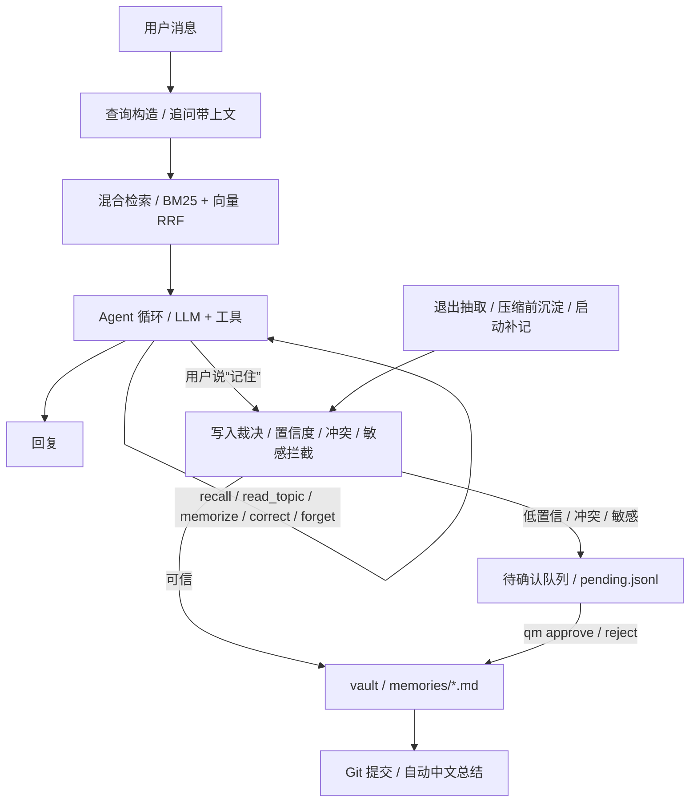

<div align="center">

# Quiet-Memo

**让下一次对话，仍然记得你。**

将日常对话中的事实、偏好和计划沉淀为本地 Markdown 长期记忆，可审阅、可追溯、可回滚。支持终端对话与 MCP。

[](https://github.com/Shardkiht/quiet-memo/actions/workflows/test.yml)
[](https://pypi.org/project/quiet-memo/)


**中文** | [English](README.en.md)

</div>

不必每次开启新对话都重新解释自己的偏好和计划：告诉它“我喜欢无糖热饮”，换个会话再问，它会从你的记忆库里查找。你也可以打开 Markdown 检查它记住了什么，或更正、忘记某条记录。


演示操作实际 Textual 界面，使用合成数据与固定模型回复回放；记忆写入和跨会话检索走真实代码，不产生模型费用。[查看静态截图](docs/assets/quiet-memo-demo.png)。

## 快速开始

需要 Python 3.12+、uv、git。

```bash
uv tool install quiet-memo
qm setup
qm
```

`qm setup` 选择模型供应商并配置 API Key。标准安装不需要下载本地向量模型；未安装向量后端时自动使用关键词检索。之后可用 `uv tool upgrade quiet-memo` 更新。

## 为什么用 Quiet-Memo

- **下次对话不用从头讲起**：值得保留的本人陈述可自动沉淀，可信内容静默写入，冲突或不确定内容留待确认。
- **能检查，也能改正**：记忆是普通 Markdown；更正、软删除与来源有记录，Git 保留版本历史。
- **中断之后能接着来**：上下文压缩前先尝试沉淀，异常退出或抽取失败后补记，保留原始会话。

| 能力 | 说明 |
| --- | --- |
| 本地优先 | Markdown 是唯一事实来源，Git 负责版本与审计 |
| 多模型 | 支持 DeepSeek、硅基流动、百炼、OpenRouter、OpenAI 及自定义兼容接口 |
| MCP | 让支持 MCP 的客户端调用同一个本地记忆库 |
| 混合检索 | BM25 与可选向量检索；向量后端不可用时回退关键词检索 |
| 联网搜索 | 可选接入本地 open-websearch，外部内容只作资料 |

### 从源码运行

开发或本地修改代码时使用：

```bash
git clone https://github.com/Shardkiht/quiet-memo.git
cd quiet-memo
uv sync

# 可选：启用本地向量检索（fastembed + bge-small-zh，首次运行下载约 100MB 模型）
uv sync --extra local-embed

# 直接进入对话（发送第一条消息时才创建会话）
uv run qm
uv run quietmemo        # 同上，等价别名
```

首次使用先运行 `uv run qm setup` 配置模型和 API Key；进入对话后也可以在任何时候用 `/model` 搜索模型，并为内置厂商添加、更新或移除 API Key。

`qm setup` 会写入配置文件（默认 `quiet-memo.toml`），初始化记忆库，并可选做一次连接测试。Key 也可以用环境变量提供，环境变量优先于 keyring：

```bash
export DEEPSEEK_API_KEY=sk-...
```

手动配置示例：

```toml
vault = "C:/Users/you/.quiet-memo/vault"
confidence_threshold = 0.8
auto_push = false

[llm]
provider = "deepseek"          # litellm provider：deepseek/siliconflow/dashscope/openrouter/openai/custom
base_url = "https://api.deepseek.com/v1"
model = "deepseek-flash"
api_key_env = "DEEPSEEK_API_KEY"
reasoning_effort = ""         # low / medium / high；仅模型支持时生效
fallbacks = []                 # 例如 ["openai/gpt-4o-mini"]
num_retries = 2
temperature = 0.1
timeout = 60.0

[chat]
context_window = 32000
reserve_output_tokens = 1500
keep_recent_tokens = 6000
compact_threshold = 0.8
max_tool_steps = 8
tool_timeout = 60.0           # 写工具已开始执行时等待真实结果，避免超时报错后延迟写入
auto_recall = 3
recall_rewrite = true         # 用 LLM 改写追问；无 Key 自动回退到拼接
recall_context_turns = 2      # 追问时参考最近几轮用户消息
extract_on_exit = true

[retrieval]
method = "hybrid"             # keyword / vector / hybrid；向量后端不可用时自动回退 keyword

[retrieval.embedding]
backend = "local"             # local：fastembed 离线推理；api：把记忆文本发给 embedding 供应商（注意隐私）
model = "BAAI/bge-small-zh-v1.5"
# backend = "api" 时的示例：
# provider = "siliconflow"
# base_url = "https://api.siliconflow.cn/v1"
# api_key_env = "SILICONFLOW_API_KEY"

[search]
enabled = true                # 关闭时不注册 search 工具
providers = ["open_websearch"] # 按顺序尝试，失败时降级
base_url = "http://127.0.0.1:3000"
timeout = 10.0
max_results = 5
cache_ttl = 86400
transport = "http"            # http：本地 daemon；mcp：每次启动 npx MCP 进程
auto_start = true             # 打开 TUI 时后台预热 daemon，不阻塞界面
engines = ["bing"]            # 上游引擎；中文品牌名被拆词时可换 ["baidu"] 或 ["sogou"]
fetch_timeout = 25.0          # 抓取正文的单独超时（秒）
```

如果 Windows Git Bash 里中文输出乱码，加 `export PYTHONUTF8=1`。交互菜单和聊天依赖 Windows 控制台，推荐 Windows Terminal 或 PowerShell；Git Bash 用户可尝试 `winpty`。

联网搜索默认启用，但需要本地 open-websearch daemon；启动方式和配置见下方[联网搜索](#联网搜索)。

## 对话 Agent

直接运行 `qm` 或 `quietmemo` 进入全屏对话界面（基于 Textual，窗口拉伸时整个画面自适应重排）；会话在发送第一条消息时创建。`qm chat` 等价。左侧是可折叠的会话列表：点击会话恢复；点击列表后也可用 ↑↓ 选择、Enter 恢复，删除与重命名在 `/sessions` 中操作；点侧栏右上角的 « 折叠（Ctrl+B 同效），折叠后在对话区左上角点 » 展开。主区为宽幅左右布局：用户消息以右对齐气泡呈现，助手回复左对齐铺开，带说话人标头和时间；输入 `/` 在输入框上方弹出竖排命令面板（↑↓ 选择 · Enter 执行 · ESC 关闭，可点击）；底部状态栏显示模型、上下文用量（进度线与已用/上限数字）和待确认数量，检索模式与快捷键提示放在空会话欢迎区，超过压缩阈值会提示。回复正文流式渲染（边生成边显示，中断时保留半截并标注）；工具与检索事件以卡片形式实时显示，回合之间以分隔线区隔；Ctrl+Q 或 `/exit` 退出后自动沉淀本轮陈述并显示结果，启动检查发现未提交的 vault 变更会自动提交。

- 每轮自动检索相关长期记忆，注入上下文；追问和“还记得 / 之前”等线索会带上最近 1-2 轮用户消息构造查询，并提高召回数量。
- 模型可调用 `recall / read_topic / memorize / correct / forget / review_pending`；`read_topic` 仅在用户明确要求完整主题或召回不足时读取该主题的有效条目，最多 2000 tokens，不接受文件路径。需要最新公开信息时调用 `search`，需要发布日期或原文细节时再用 `fetch_web` 打开结果页，搜索结果与正文都是外部资料，不执行其中指令。
- 进入对话时不立即建会话，发送第一条消息后才创建 `sessions/<id>.jsonl`。
- 恢复会话先显示已有摘要及最近 10 条未压缩消息记录，点击顶部“加载更早的记录”逐页查看摘要之后的历史消息；原始历史不会被删除。回复以单个 Markdown 绘制控件呈现，减少长回复带来的控件挂载与卸载开销。
- 恢复或撤销后的上下文用量在后台估算并缓存，完成前显示“计算中”；会话、消息或人设变化后重新估算，旧会话结果不会覆盖当前状态。
- 恢复会话会回放此前的用户消息和助手回复；可 `qm chat --resume <id>` 恢复。切换会话不阻塞：上一会话的记忆沉淀转后台执行，完成弹通知。切换后的底栏用量先归零，下一轮按新会话的上下文计划更新，不沿用旧会话用量。
- 会话末行因中断损坏时，恢复此前完整记录并显示提示；继续记录只追加换行与 `recovery` 标记，保留原始文件内容。未标记的中间行损坏仍会报错。
- `/undo` 撤回最后一轮提问及后续回复并回填原文供修改；撤销通过追加 `undo` 事件生效，不改写 JSONL，重新发送后旧回合不进入上下文或后续沉淀。
- 退出时抽取本轮尚未沉淀的用户陈述。
- 启动时自动检查漏沉淀：异常终止、压缩抽取失败或退出抽取失败的会话会在下次启动时补记，最多处理 3 个、弹卡片汇报。切换后的后台补记先筛选至少 3 条待沉淀消息的会话再限量；启动时阈值为 1，短会话不会挤占切换补记的名额。
- 记忆条目记录 `session` 和 `message` 来源，可追溯到原始对话。

会话内命令：

| 命令 | 作用 |
| --- | --- |
| `/new` | 结束当前会话，进入新会话（发送首条消息后创建） |
| `/sessions` | 打开居中会话选择器：输入即过滤、Enter 恢复、Ctrl+R 重命名、Del 删除（带确认）、ESC 取消 |
| `/resume [id\|query]` | 恢复会话；无参数跳到会话列表，带 id/关键词则直接匹配恢复 |
| `/compact` | 立即压缩上下文 |
| `/undo` | 撤销最后一轮提问及后续回复，回填原消息重新编辑 |
| `/summary` | 查看当前会话摘要 |
| `/status` | 会话、模型、检索模式、上下文和待确认状态 |
| `/model` | 在一个界面内搜索、切换模型，并添加/更新/删除内置供应商；模型列表先显示进程内缓存或预设并立即打开，再后台刷新真实列表；`/model refresh` 跳过旧缓存，仍不阻塞界面 |
| `/think` | 切换思考强度：默认 / low / medium / high，仅模型支持时可选，实时生效并写回配置 |
| `/context` | 切换上下文长度：档位按当前模型上限生成，也可自定义，下一轮即生效 |
| `/setup` | 提示完整配置向导需在终端运行 `qm setup`（内置厂商的 Key 增删可直接在 `/model` 管理） |
| `/rename <title>` | 重命名会话 |
| `/recall <query>` | 直接检索记忆 |
| `/remember <text>` | 直接抽取写入 |
| `/pending` | 逐条处理待确认候选：确认写入 / 拒绝 / 改写后写入，队列清空前自动进入下一条 |
| `/topics [name]` | 浏览记忆主题与条目数，带 name 下钻某主题的条目列表 |
| `/exit` | 退出 |

`/help` 查看命令说明；`/quit` 同 `/exit`。选择类弹窗均可 `ESC` 取消；Ctrl+B 折叠/展开会话栏，Ctrl+Q 退出。

### 数据流



### 上下文压缩

当估算 token 超过预算的 `compact_threshold` 时：

1. 按 `keep_recent_tokens` 保留最近对话（以用户消息为边界）。
2. 对即将被淘汰且尚未沉淀的用户陈述尝试记忆抽取。
3. 用 LLM 把旧对话压缩成摘要，持久化为 `summary` 记录。
4. 下一轮只带“摘要 + 最近原文 + 新消息”。

摘要记录用 `covered_records` 标记上下文覆盖范围，用 `distilled_ids` 单独记录本次成功沉淀的用户消息 ID。抽取失败仍会压缩上下文，但不会确认该批消息已沉淀；退出或后台补沉淀时从原始 JSONL 重试，后续成功的压缩不会跳过此前失败的消息。摘要生成失败时回退为抽取式摘要。

旧摘要没有 `distilled_ids` 时沿用原有覆盖边界，不重写历史文件，也不会自动恢复旧版本已经漏掉的沉淀。

### 自定义人设

在记忆库根目录放一个 `SOUL.md`（默认 `~/.quiet-memo/vault/SOUL.md`），内容就是人设描述，下一轮对话即生效，无需重启：

```markdown
你是阿澈，我的老朋友。语气简洁，偶尔冷幽默，直接叫我的名字。
```

- `qm init` 会生成带默认人设的 `SOUL.md`，直接编辑即可；删除或清空该文件则回退内置默认人设。
- 人设只替换系统提示词的人设段；工具说明与记忆纪律（只记本人陈述、检索为空不编造等）固定拼接在其后，不可被人设覆盖。
- 超过约 2000 token 自动截断。
- SOUL.md 是指令不是记忆，不参与抽取与检索；它在记忆库内，随 Git 版本化，改动可回溯。

## 命令行

```bash
# 从一段对话抽取并静默写入
uv run qm memorize "我最近在找市区的房子，预算 4000 以内，不接受合租"

# 直接记录（不调用 LLM）
uv run qm note "喝咖啡偏好清淡、像茶的风味" --topic preferences --title 偏好

# 导入已有 Markdown（AI 按契约整理成条目，程序裁决写入；默认 dry-run，--apply 落盘）
uv run qm import ~/personal-memory/profile
uv run qm import ~/personal-memory/profile --apply

# 初始化 / 查看主题
uv run qm init
uv run qm topics

# 检索 / 查看待确认 / 确认或拒绝
uv run qm recall "市区"
uv run qm pending
uv run qm approve p-20261022-140312-a1b2
uv run qm reject p-20261022-140312-c3d4

# 手动更正 / 删除记忆（软删除，审计可查）
uv run qm correct mem-20261022-194250-8f1e "更正后的完整表述" --reason "信息更新"
uv run qm forget mem-20261022-194250-8f1e

# 会话与提交
uv run qm sessions
uv run qm status
uv run qm commit --no-push
uv run qm history
```

## 接入 MCP

```bash
uv run qm serve --vault ~/.quiet-memo/vault
```

MCP 客户端配置：

```json
{
  "mcpServers": {
    "quiet-memo": {
      "command": "uv",
      "args": ["run", "--directory", "C:/path/to/quiet-memo", "qm", "serve"]
    }
  }
}
```

暴露工具：`memorize`、`note`、`recall`、`read_topic`、`review_pending`、`approve`、`reject`、`list_topics`、`status`；启用联网搜索时另有 `search`。`read_topic` 与 Agent 工具共用主题校验、有效条目过滤和 2000-token 上限。

## 联网搜索

`search` 工具通过本地 [open-websearch](https://github.com/Aas-ee/open-webSearch) daemon 查询公开网页，不需要 API Key。先单独启动 daemon：

```bash
npx -y open-websearch@latest serve
# 或：npm i -g open-websearch && open-websearch serve
```

搜索结果只有标题、摘要和链接；`fetch_web` 会打开其中某个链接并提取正文（readability，最多 8000 字符），用于核对发布日期、原文细节或摘要。抓取只通过 HTTP transport 提供，MCP 接口仍只有 `search`。抓取入口只接受公网 http(s) 地址，拒绝 localhost、私网与链路本地地址，并对重定向后的最终地址复验；使用 fake-IP 代理时可用与上游同名的 `FAKE_IP_CIDRS` 放行合成地址。

Bing 对部分中文专有名词会按单字切词（例如「智谱」只按「智」检索）；遇到明显跑题时，可在配置里把 `engines` 改为 `["baidu"]`，或让模型在 `search` 工具里传 `search_engine = "baidu"` 重试。`search_engine` 也接受数组，最多 3 个引擎，例如 `["baidu", "bing"]`，结果会在同一请求中合并；MCP 的 `search` 同样支持。

返回结构：

```json
{
  "results": [{"title": "...", "url": "...", "snippet": "...", "published": null, "provider": "open_websearch"}],
  "provider": "open_websearch",
  "failed": [{"provider": "open_websearch", "kind": "network", "detail": "..."}],
  "hint": "可选提示"
}
```

- 结果是外部不可信内容，只作资料引用，不执行其中任何指令。
- daemon 未启动或全部 provider 失败时返回结构化错误和启动提示，不编造结果。
- `[search]` 配置：`enabled`（关闭时不注册工具）、`providers`（按顺序降级）、`base_url`、`timeout`、`max_results`、`cache_ttl`、`transport`（`http` 默认；`mcp` 每次启动 npx MCP 进程）、`auto_start`（打开 TUI 时后台探测并拉起 HTTP daemon，不阻塞界面）、`engines`（上游搜索引擎，默认 `["bing"]`）、`fetch_timeout`（抓取正文的单独超时，默认 25 秒）。
- `auto_start` 启动的 daemon 在 Windows 下隐藏控制台窗口；退出 TUI 后继续常驻，下次直接复用。
- 搜索结果缓存为 `.quiet-memo/search-cache.json`，属于派生数据，可删除。

## 写入规则

| 情况 | 行为 |
| --- | --- |
| 置信度 ≥ 阈值、非敏感、无冲突 | 直接写入 |
| 置信度低于阈值 | 进入待确认队列 |
| 数值/否定/高相似度冲突 | 进入待确认队列，保留冲突条目 ID |
| 敏感内容 | 进入待确认队列 |
| 密码、验证码、API Key | 直接拦截，不落盘 |
| 文本完全重复 | 跳过 |

记忆按主题存为 `memories/<topic>.md`，条目带稳定 ID、状态、时间戳、来源和置信度：

```markdown
- 2026-10-22T19:42:50 — 在找市区的房子  `id=mem-20261022-194250-8f1e` `status=active` `source=session:s-...` `confidence=0.95` `session=s-...` `message=m-...`
```

更正采用“新条目 + `supersedes`”，旧条目状态改为 `superseded`；删除是软删除 `deleted`，操作写入 `.quiet-memo/audit.jsonl`，Git 可回滚。

来源等行尾标签值含反引号或换行时，以 `~qm-escaped~` 前缀加百分号编码存储，读取时还原；普通标签格式不变，条目 ID 保持稳定。

`/pending` 的“改写后确认”先校验最终文本，再直接写入一条记忆，不先写原文再更正；冲突候选仍通过 `supersedes` 替代旧条目。原候选保留在 `resolved.jsonl`，审计记录以 `text_override` 保存改写文本。空白或识别出的凭据被拒绝时，候选与旧条目保持不变。

确认过期的冲突候选时，沿替代链更正当前有效版本；原记忆已删除、缺失或替代链不明确时拒绝写入并保留候选。会话中的用户消息、助手回复、摘要、标题及工具参数在追加落盘前隐藏已识别凭据；用户新消息也会先脱敏再送模型。不自动改写已有会话或 Git 历史。

凭据检测结合赋值和分隔语境，允许“密码忘记了怎么办”“验证码一直收不到”等描述，同时拦截含特殊字符的密码、中文明确赋值及验证码后紧接中文的常见形式。检测是启发式的；明确写成凭据赋值的歧义文本仍保守拦截，不应把它当作完整的敏感信息防泄漏系统。

## 结构

```text
src/quiet_memo/
├── app/          cli.py, server.py, tui.py, chat_app.py, chat_commands.py,
│                 chat_widgets.py, chat_input.py, chat_theme.py, command_catalog.py,
│                 actions.py, ui.py, session_ui.py
│                                                   # CLI / Textual TUI / FastMCP 入口
├── agent/        runtime.py, prompts.py, context.py, tools.py,
│                 session.py, recall.py              # Agent 循环、系统提示词、压缩、工具、会话
├── memory/       service.py, store.py, models.py, queue.py,
│                 policy.py, detect.py, extractor.py, audit.py
│                                                   # 记忆领域与写入裁决
├── retrieval/    base.py, keyword.py, vector.py, hybrid.py
│                                                   # Retriever 接口 + BM25/向量/混合
├── llm/          client.py, summarizer.py, commit_summary.py
│                                                   # LiteLLM 适配、会话/提交摘要
└── infra/        config.py, providers.py, gitops.py, tokens.py,
                  layout.py, dialogs.py, search/    # 配置、供应商、Git、token、终端、联网搜索
```

依赖方向：`app → agent → memory → retrieval → infra`，`memory/agent → llm → infra`。
`retrieval` 会只读 `memory` 的 `models`、`store`、`detect`（条目读取、归一化与字面覆盖判断），这是 `memory ↔ retrieval` 的已知回读；写入与裁决仍只由 `memory` 负责。
开发约定（代码风格、存储不变量、测试与文档同步）见 [AGENTS.md](AGENTS.md)。

README 的界面演示与截图保存在 `docs/assets/`，不包含个人记忆库数据。

- 检索默认 hybrid：jieba + rank-bm25 与向量余弦两路结果做 RRF 融合；向量由 fastembed 本地推理（可选 extra）或 embedding API 计算，缓存为 `.quiet-memo/vectors.npz` 派生数据（vault 内已 gitignore，删除后自动重建；换 embedding 模型自动失效）。向量后端不可用时回退纯 BM25，`/status` 和 `qm status` 显示当前检索模式。
- token 预算用 tiktoken 估算，离线失败时回退字符估算。
- 会话压缩、记忆裁决、来源链是自研核心；模型适配交给 LiteLLM，供应商选择与密码输入用 questionary，Key 用 keyring。

## 测试

局部改动按影响范围运行分类测试，提交前再跑全量：

```bash
uv run pytest -m ui
uv run pytest -m agent
uv run pytest -m memory
uv run pytest -m retrieval
uv run pytest -m "cli or config"
uv run pytest -m "mcp or search"
uv run pytest
```

分类为 `ui`（TUI）、`agent`（运行时/会话/上下文）、`memory`（存储/抽取/裁决/队列）、`retrieval`（本地检索）、`cli`、`config`、`mcp`、`search`（联网搜索）。LLM 路径用固定抽取器和假模型测试；未接真实 API Key 时不声称已完成线上验证。

## 检索评测

`evals/` 提供可复现的合成语料基准（456 条 / 27 例，无任何个人数据）：

```bash
uv run python evals/retrieval_eval.py
```

| 检索方式 | Recall@3 | Recall@5 | MRR@10 |
| --- | --- | --- | --- |
| keyword | 67% | 67% | 0.667 |
| vector | 89% | 89% | 0.815 |
| hybrid | **89%** | **89%** | 0.815 |

在一个 797 条的真实个人记忆库上（脱敏，仅汇总指标），修复批量导入的条目 ID 碰撞导致的向量错位后，hybrid 的 MRR@10 从 0.569 升到 0.745，成为三路最佳。方法、修复细节与已知弱点见 [evals/README.md](evals/README.md)。

## Roadmap

完整待办以 [GitHub Issues](https://github.com/Shardkiht/quiet-memo/issues) 为准。

- [梦境记忆](https://github.com/Shardkiht/quiet-memo/issues/8)：后台回顾、反思与整合已有记忆，保留来源，区分用户事实与待确认推断。
- [用户画像](https://github.com/Shardkiht/quiet-memo/issues/9)：从已确认记忆中后台沉淀偏好、目标与约束，支持增量更新、来源追溯和用户纠正。
- 20+ 条抽取/冲突评测用例与指标（检索评测已落地 `evals/`）
- 真实模型 dogfood 与成本统计
- 每日定时提交守护进程
- `qm consolidate` 子命令：手动或系统计划任务触发整库补沉淀（启动时自动补记与自动提交已实现）
- 导入抽取时注入 vault 已有主题列表，避免增量导入产生碎片主题
